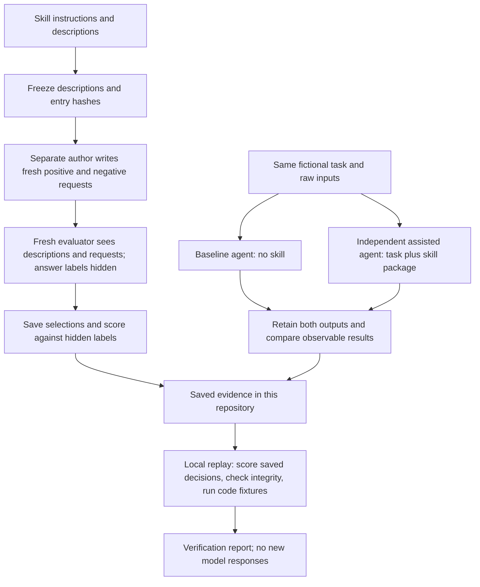

# Evaluation cases and evidence

[cases.json](cases.json) contains seven raw task fixtures plus three selection-positive and two selection-negative requests per skill. [results](results/) retains actual outputs, routing decisions, generated test code/logs, and the assisted design calculator. Inputs use a fictional tool-sharing product; no personal source inventory is included.

## How the evaluations work

We ask three separate questions: **Does the agent select the right skill? Does using it improve the work? Can we verify the saved evidence later?** A routing score answers only the first question.



### 1. Selection: would the agent choose this skill?

Positive requests should select the target skill; negative requests should not. A negative can correctly select another skill. The evaluator may select multiple skills, so the score measures the **target skill's presence or absence**, not whether the entire selected set exactly matches an answer key.

For the [four history-derived skills](history-skills/README.md), a separate author wrote two positives and two negatives per skill after the descriptions were frozen. A fresh evaluator saw all eleven skill descriptions and the sixteen shuffled requests, without the expected labels or skill bodies. It scored **16/16 target decisions**. This tests selection from supplied descriptions; it does not test native Codex or Claude Code discovery.

Earlier routing results remain separate: **32/35 initially**, **35/35 after description/request revisions**, **35/35 on the unchanged existing requests**, and **28/28 on an earlier fresh set**. Revised requests do not count as independent fresh evidence. No cases were edited to improve the sixteen-case result.

### 2. Paired tasks: does the skill improve the result?

Two independent agent sessions get the same fictional tasks and raw inputs with the same inherited model/settings. Only the assisted session gets the skill packages. Neither sees the other's outputs or answer keys. We retain the actual responses and any generated code/logs, then compare them against observable task criteria.

The newest pairs covered triage and prose editing:

| Task | What the comparison showed |
| --- | --- |
| Review finding triage | Both identified the same valid defect and proposed the same dispositions. Assisted output made finding identity and decision/application state more explicit. No improved classification or completed resolution was demonstrated. |
| Prose editing | Both preserved the facts and met the editing direction. Baseline: 51 words; assisted: 53. No quality gain was demonstrated. |

These were actual agent runs, but triage involved static reasoning and planned commands. No live review tool, dismissal, dashboard, server, or device test ran. With no repeated trials or blinded numerical quality grading, these pairs do not establish a general performance advantage. Later instruction changes, including the owner override clarification, have not received a new paired run.

### 3. Replay: can we still verify what was recorded?

Replay reads the saved evidence. It recalculates routing scores, checks frozen descriptions and recorded hashes, and checks retained outputs for specific properties such as preserved facts and explicit uncertainty. It also executes saved regression-test fixtures, contrast calculations, and a review-defect reproduction from earlier evaluations in temporary directories.

Some code fixtures **must fail an assertion** because their purpose is to expose a known bug. Replay passes only when the expected failure occurs; a broken test import or environment error is not accepted as evidence. A passing replay means these checks succeeded. It does not regenerate agent responses, judge every reasoning claim, or prove that every current procedure has been behaviorally tested.

| Where to look | What it contains |
| --- | --- |
| [History-derived evidence](history-skills/README.md) | Latest selection cases, paired inputs/outputs, and limitations |
| [Earlier results](results/) | Earlier routing decisions, reports, generated tests, and execution logs |
| [Validation report](../validation.md) | Results across passes, source checks, and what actually ran |
| [Library checker](../scripts/check_library.py) | Package structure, metadata, links, contract copies, and basic hygiene |
| [Evaluation replay](../scripts/replay_evaluations.py) | One command to verify saved evidence and execute included code fixtures |

## Behavioral runs

To reproduce a baseline, create an isolated directory per task, write its `artifacts` to their relative paths, and give a fresh agent the `request` only. Do not expose skill text or expected results. For the assisted run, create the identical raw fixture and give another agent the selected skill’s complete package. Preserve output.md, any requested test code, executed commands, exit codes, and exact errors. Use the same model/settings, isolate baseline from assisted outputs, and restrict execution to local fixtures without network or external mutations.

For selection, give an evaluator only skill names/descriptions and the requests, with stable case IDs. Require zero or more selected skill names and rationale. Keep expected positives/negatives hidden until scoring. Each negative is a negative for its target skill; it may legitimately match another skill. Retain failed or ambiguous cases as well as reruns.

The completed paired run used one evaluator session for seven baseline tasks and a separate session for seven assisted tasks, with inherited session settings and no overrides. The two routing rounds each used a fresh evaluator. This design prevents baseline access to skill content, but has no repetition or per-task randomization. See [validation.md](../validation.md) for results and limitations.

## Review criteria

| Task | Observable criteria |
| --- | --- |
| Requirements | Draft rather than interview when requested; core journey, scoped MVP, budget, non-goals, signals, and explicit unknowns |
| Technical design | Concrete stack with rationale, budget uncertainty, ownership, concurrent non-overlap, tests and unresolved choices; assisted run should use author defaults absent an override |
| Design | Concrete semantic tokens, actual text/muted/status contrast calculations, guide-only boundary, states and later integration checks |
| Git | Canonical main-only policy overrides old issue guide; preserve published history and unrelated notes; explicit PR gate and unverified refs |
| Issues | Exact native-ID lookup, no duplicate manual claim around wrapper, correct completion gate, no invented sync authorization |
| Review | Find unauthorized mutation and inadequate assertion, with location/evidence; remain read-only |
| Testing | Derive half-open adjacency from spec, run standard-library tests, expose intentional bug, retain failures, leave implementation untouched |

These criteria were used for manual comparison of actual outputs; they are not a claim that a separate blinded judge assigned numerical quality scores.

## Deterministic replay

From the library root:

```sh
python3 scripts/check_library.py
python3 scripts/replay_evaluations.py
```

Replay creates temporary fixtures, reruns the two saved test suites and assisted contrast calculator, verifies the known review defect, and scores stored routing decisions. It **does not** call a model or regenerate an agent response. Expected test failures are distinguished from collection/environment errors. Initial routing evidence is retained because the first round revealed a description gap and two underspecified positive requests.

## Current revision and fresh cases

Final descriptions/entry hashes were frozen in [final-descriptions.json](final-descriptions.json) before a separate author wrote [28 new cases](fresh-cases.json). They were evaluated with hidden labels after the descriptions were final. Existing v2 request IDs and texts were reused verbatim for the 35-case rerun. Current inputs, answers, and actual model outputs use `current-existing` and `fresh` suffixes under results. No prompt was edited after seeing either score.

Historical artifacts received identifier/path normalization only. [history.json](history.json) retains pre-normalization raw JSON digests and request-equality checks; the exact originals remain outside the checkout. Historical behavior and original scores were not replaced.

The new paired run is under `results/current-pair/`, with two raw fixture tasks per evaluator and separate baseline/assisted sessions. It supplements rather than overwrites the earlier seven-task run. Replay checks both generations. The current spec conclusion did not change; assisted review withheld unsolicited fixes and included executable evidence. Regression defect detection did not change; report and test organization did. See the root report for limits.
